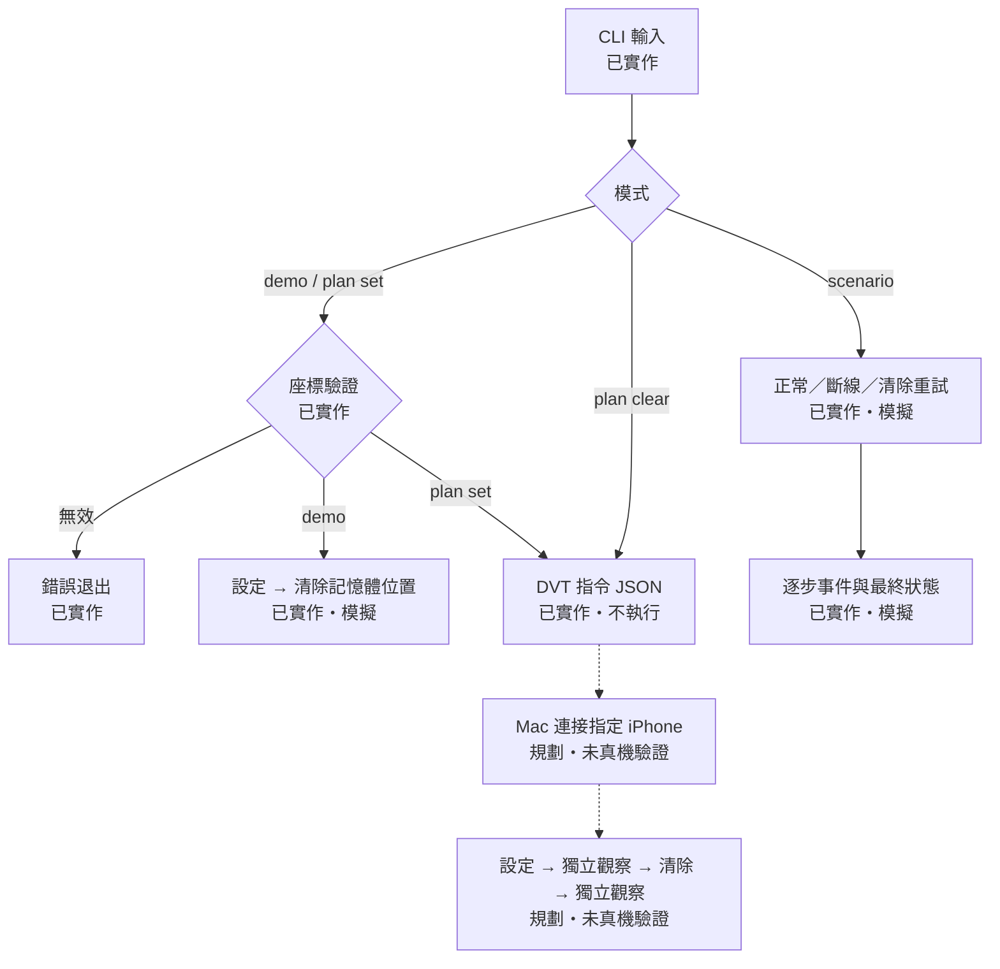
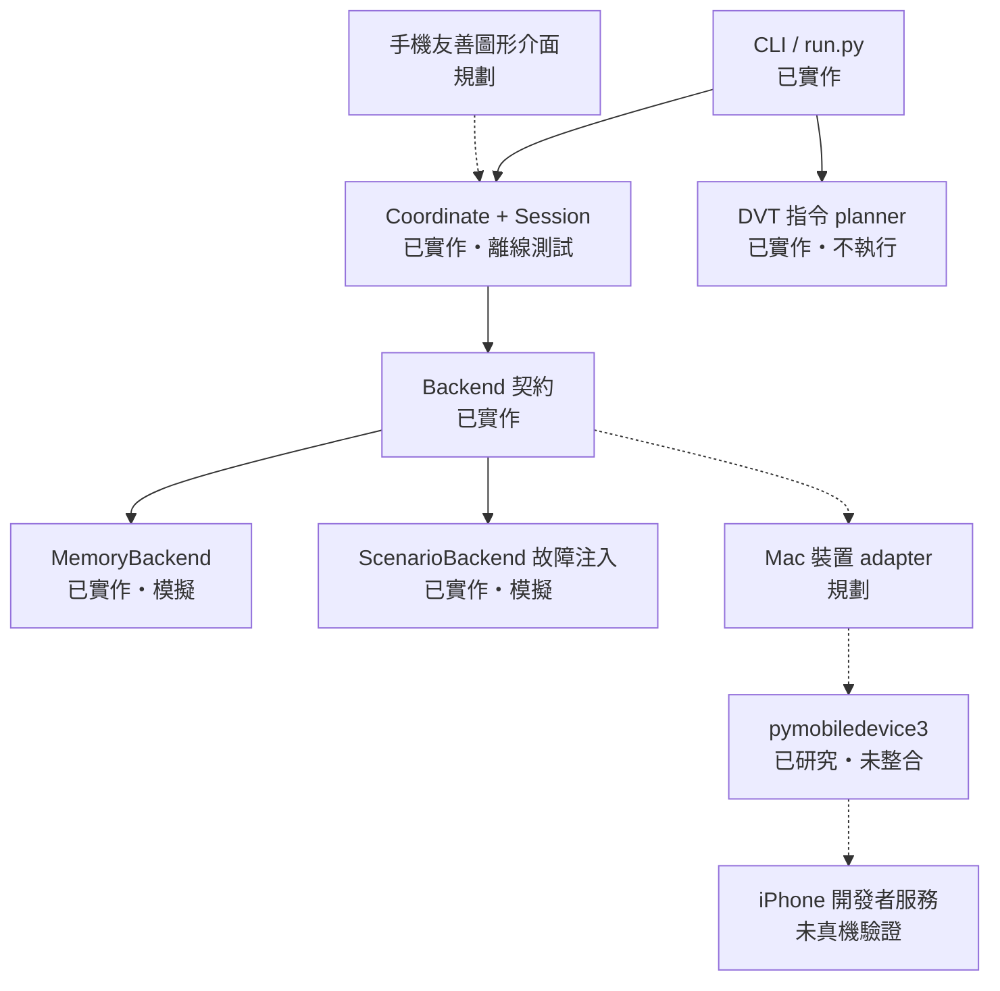
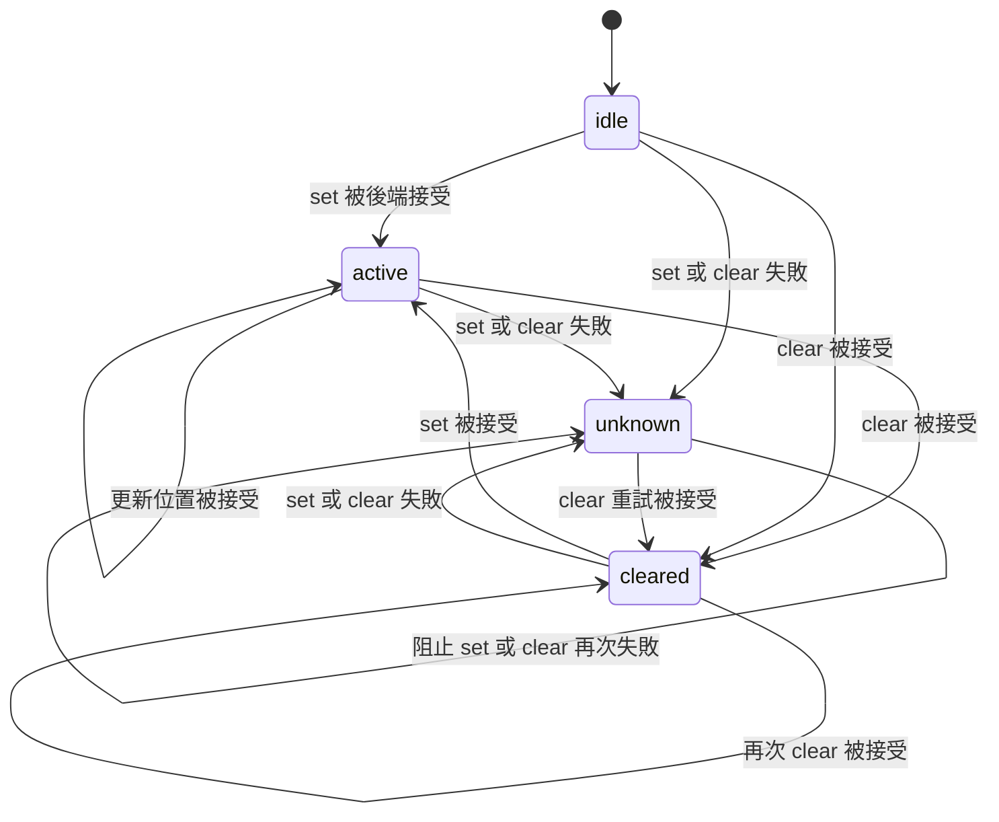

# 執行流程與系統架構

2026-11-07。實線是現有程式路徑；虛線是規劃。
「已實作」不代表真機已驗證。「模擬」表示只改記憶體，沒有操作手機。

## 執行流程

手機閱讀版：輸入座標 → 檢查範圍 → 選離線演練或指令預覽。
故障演練使用固定公開範例座標，不需要你的實際位置。
plan clear 不需要座標。現在所有路徑都不會連接 iPhone。

## 系統架構

手機閱讀版：介面負責輸入；核心負責驗證與狀態；
後端負責實際操作。目前只有記憶體及故障模擬後端。
未來接 Mac 裝置後端，才有可能把操作送到 iPhone。

## 失敗與恢復

上圖為已實作狀態規則，在 mock 中測試。
active 不是位置觀測結果；cleared 也不是確認 GPS 已恢復。
真機加入後，仍要另外顯示「獨立觀察：未驗證／已觀察」。

## 現階段設計決策

1. 先驗證核心和恢復流程：手機可以先看結果，Mac 到手再驗證硬體。
2. UI 與裝置操作分開：之後換地圖或 Mac UI 不需重寫狀態管理。
3. 失敗顯示 unknown：可能已部分操作，不能假裝安全恢復。
4. 不延續 WLoc 代理作為主線：它的近期失效原因仍有待驗證；研究見 research.md。
5. 介面形式、正式名稱、地圖供應商與公開授權尚未決定，現在不用先選。

下一步適合讓 維護者 參與的是手機介面的資訊順序：
選地點 → 看連線裝置 → 設定 → 查看狀態 → 恢復。先做離線 UI，仍需另行實作。
