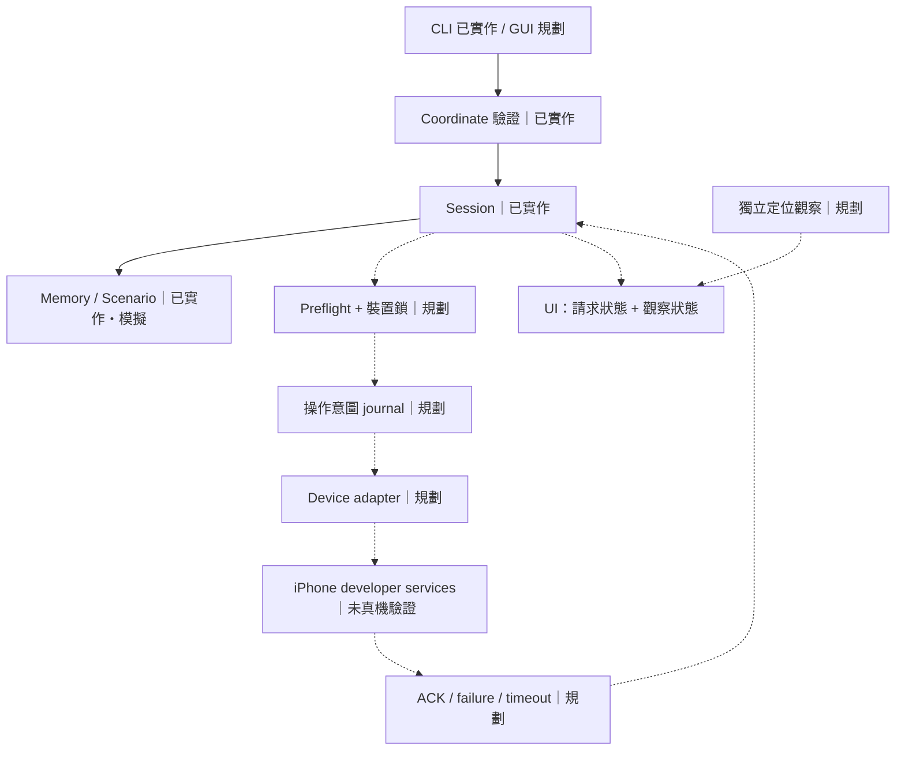

# 系統設計與實作計畫

更新：2026-11-11。狀態：架構提案；離線核心已實作，裝置 adapter 尚未實作。

## 產品邊界與成功條件

Location Lab 是以 Mac 為主機的 iPhone 定位模擬研究工具。
輸入是 WGS84 經緯度，並非改變 IP 出口，也不修改 GPS 硬體訊號。
第一個真機版本只做單一裝置、單點設定、清除及獨立觀察。
不承諾第三方 App 接受結果；不做遊戲自動化、憑證釘選繞過或系統信任資料庫修改。

技術成功條件：指定裝置可以建立開發者通道、接受 set、由獨立 App 觀測變化、
接受 clear 並觀測恢復；斷線與異常不得誤報恢復。缺任何一步都不是完整驗收。

## 元件及責任

| 元件 | 現狀 | 責任與邊界 |
| --- | --- | --- |
| CLI / run.py | 已實作 | 輸入、顯示 mock 或計畫，不連手機 |
| Coordinate | 已實作 | WGS84 範圍與有限數字檢查；不隱式轉 GCJ02 |
| Session | 已實作，同步單程序 | idle/active/cleared/unknown；失敗後拒絕 set |
| MemoryBackend / ScenarioBackend | 已實作、模擬 | 正常、部分寫入後斷線、clear 失敗再試 |
| Command planner | 已實作 | argv JSON，不執行；尚無裝置選擇，不可直接當正式執行器 |
| Device discovery / preflight | 規劃 | 枚舉、明確選一台裝置、檢查版本/配對/服務 |
| Session supervisor | 規劃 | 每裝置一個 owner、序列化操作、取消、存活監控 |
| pymobiledevice3 adapter | 規劃 | 隔離上游 API / CLI 差異；固定版本後整合 |
| Recovery journal | 規劃 | 執行前記錄意圖；程序死亡後視為 unknown，不自動重設位置 |
| Observation | 規劃 | 與指令 ACK 分開；來源、時間、偏差、手動/自動標記 |
| UI | 規劃 | 首先本機介面，手機遠端控制不屬於第一個真機里程碑 |

## 資料流

set 規劃流程：驗證輸入 → 選定唯一裝置 → 檢查相容條件 →
取得裝置操作鎖 → 寫入 pending 意圖 → 啟動/維持 session →
收到 ACK 標示 active → 等待獨立觀察。失敗/逾時/中斷均回 unknown。
clear：保持同一裝置關聯 → 送清除 → ACK 僅標示 cleared →
獨立觀察確認；失敗保留 unknown 並允許重試。
恢復時不得默默選第一台裝置，也不得自動重放上次目標座標。

## 資料契約（規劃，尚未新增持久化）

- LocationRequest：request_id、schema_version=1、coordinate_system=wgs84、lat/lon、session_id。
- DeviceHandle：opaque 本機識別、iOS build、host build、transport、backend version。
  真實 UDID 僅供本機 adapter 使用，UI 與匯出使用別名。
- OperationResult：request_id、accepted/failed/timeout、session_state、錯誤分類、timestamp。
- Observation：unverified/observed、來源、觀察時間；不得由 ACK 自動改成 observed。
- Journal：schema_version、device 別名、最後未完成操作、狀態及時間。
  預設不存座標；權限限制至本機使用者，原子寫入與損壞降級 unknown。

錯誤分類：invalid_input、ambiguous_device、untrusted、developer_service_unavailable、
unsupported_version、transport_lost、timeout、cancelled、recovery_failed。
不可把 raw exception 或配對資料完整回傳給未來網頁 UI。

## 技術決策

ADR-002：先以標準庫核心 + 隔離 adapter 驗證單點流程。暫不整合 Web server、地圖服務、
資料庫或容器，避免核心可行性未驗證就堆出維護成本。

ADR-003：不在此時選 subprocess 或直接 Python API 作最後實作。
pymobiledevice3 set 具有長連線生命週期；先以真機 spike 量測取消/清除/斷線行為。
CLI 包裝可隔離相依環境但要處理 stdin、事件解析、版本漂移與子程序；API 有較明確事件
但耦合上游與授權。兩者都要版本固定，不把 subprocess 當成 GPL 豁免。

ADR-004：WLoc 僅作架構參考。其代理/信任鏈問題與 DVT 不同；
新語言重刻同一代理不構成根因修復。不得自動重置裝置或封鎖系統更新。

## 分階段交付與驗收

| 階段 | 可交付成果 | 完成門檻 / 依賴 |
| --- | --- | --- |
| P0 公開研究骨架 | 文件、離線 CLI、測試、原始碼包 | 已具備；公開授權/目的 repo/寫入通道待確定 |
| P1 核心強化 | 非同步狀態、操作鎖、journal、fake transport | 斷線/取消/逾時/損壞/重啟/重複請求測試通過；不接真機也可做 |
| P2 真機 feasibility spike | 固定上游版本與測試報告 | Mac+iPhone 可用；單台 set/clear 與獨立觀察成功；失敗則停止 UI 擴充、記錄原因 |
| P3 最小實機 adapter | 明確選裝置、preflight、session owner、恢復 | 故障矩陣通過；未測版本顯示 unverified |
| P4 本機 UI | 座標、裝置別名、請求/觀察狀態、恢復按鈕 | 操作序列清楚，未知狀態不能假裝成功；先不開 LAN |
| P5 公開 release | 授權、固定依賴、建置流程、相容矩陣 | CI + 真機證據 + 隱私檢查；不以原型 ZIP 宣稱成品 |

不以日期估工替代驗收門檻；未知硬體相容性是 P2 關卡。
公開 repo 可以先是離線研究原型，不需要等所有硬體功能完成，但必須如實標示。

## 測試策略

已執行：Linux Python 3.12 的 19 個 unittest；核心和 CLI 離線情境。
規劃 CI：Linux / macOS × Python 3.11、3.12、3.13；尚未建立或執行 GitHub Actions。
新增 adapter 前測：多裝置歧義、部分 set 成功、clear 逾時、取消競態、
重啟 journal 恢復、同裝置併發、重複 request、版本不合與輸出遮罩。
真機矩陣：完整 iOS build / Mac OS build / CPU / Python / 上游版本 / USB或Wi-Fi，
記錄 set、維持、clear、拔線、鎖屏、退出、重連；只對實測組合宣稱支援。
